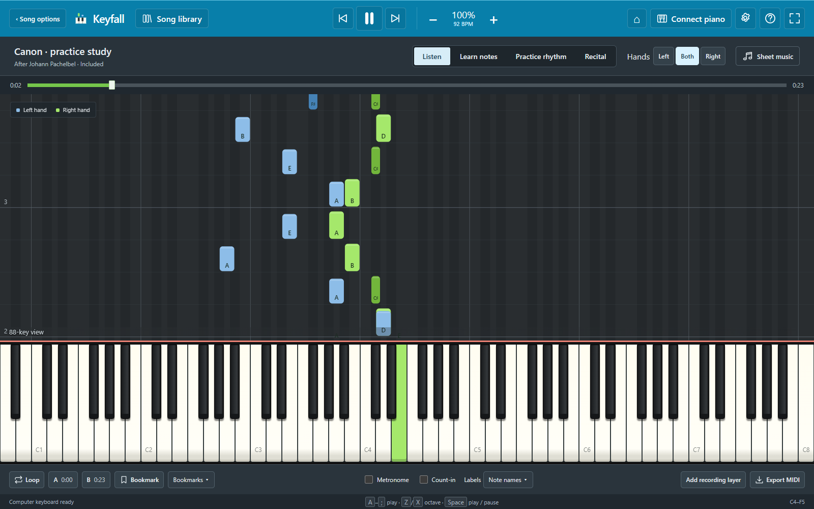
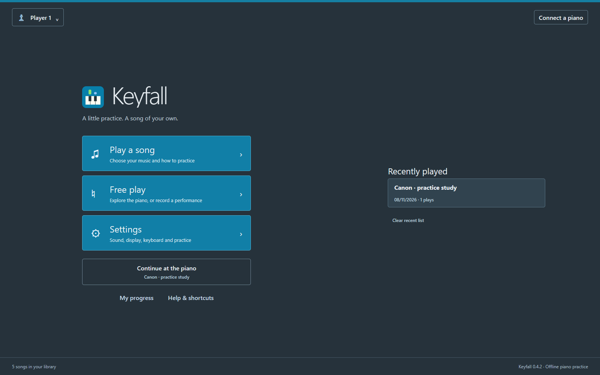
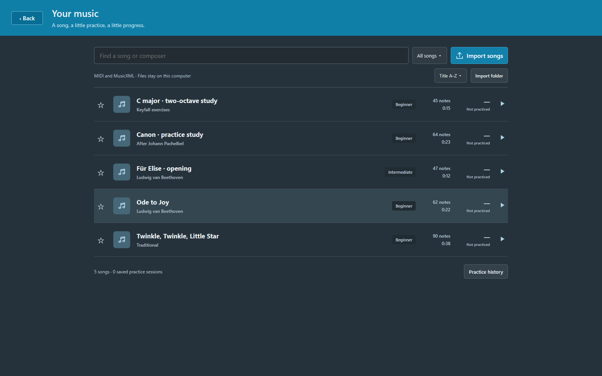
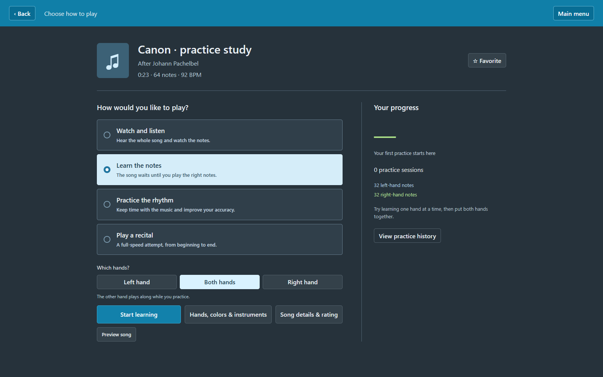
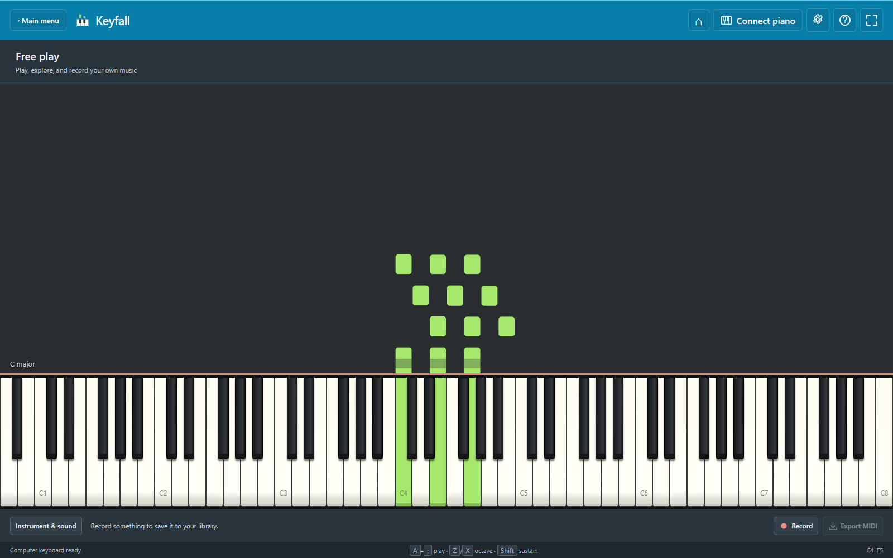

# Keyfall 🎹

**Offline piano practice, falling notes, and a space to play your own music.**

Keyfall is an independent piano-practice app built by [Don Gabriel](https://github.com/Don-Gabriel), with AI assistance. It began as a personal alternative to paying for a falling-note piano-learning workflow and grew into a song library, practice tools, free play, recording, and sheet music.

No account, subscription, cloud service, or paid API is needed to play. Audio assets are bundled. This project is not affiliated with Synthesia and does not use its application code or lesson assets.



## Downloads

Download **v0.5.0** below. Windows is the primary release; Android and macOS are previews. Use the platform package, not GitHub's source archives, to install.

| Platform | Status | Notes |
|---|---|---|
| Windows x64 | [Download installer (.exe)](https://github.com/Don-Gabriel/keyfall/releases/download/v0.5.0/Keyfall-Setup-0.5.0-x64.exe) | Windows 10/11; Chrome or Edge required. Bundled Node runtime; no development tools needed. |
| Android | [Download signed preview (.apk)](https://github.com/Don-Gabriel/keyfall/releases/download/v0.5.0/Keyfall-0.5.0-Android.apk) | Offline touch piano. USB MIDI, watched folders and printing are desktop-only. |
| macOS | [Download universal preview (.zip)](https://github.com/Don-Gabriel/keyfall/releases/download/v0.5.0/Keyfall-0.5.0-macOS-universal.zip) | Intel and Apple Silicon; unsigned and not notarized. |
| iPhone / iPad | [iOS source project](ios/); no installable IPA | Simulator compilation passed. Apple signing/provisioning and device testing are still required for distribution. |

[All releases](https://github.com/Don-Gabriel/keyfall/releases) · [Report a bug](https://github.com/Don-Gabriel/keyfall/issues)

The Windows installer runs per user and supports uninstall. Preview packages are early builds: compilation or an emulator check does not certify every device. The release notes identify which checks were actually run.

Windows and macOS packages are not publisher-signed; Android is signed with the project's release key and is distributed directly, outside Google Play. Follow your operating system's security prompts only for a download you trust. Release assets include SHA-256 checksums for file verification.

## What you can do

- **Play your music:** import MIDI (`.mid`, `.midi`) and MusicXML (`.xml`, `.musicxml`, `.mxl`), search your library, favorite pieces, and edit ratings and song details.
- **Watch and listen:** follow a full piano roll with separate hand colours, adjustable speed, transposition, labels, and keyboard range.
- **Learn the notes:** wait for the right notes, practise one hand while the other plays along, and choose held or sequential chord rules.
- **Practise rhythm or a recital:** track correct, incorrect and missed notes with local practice history.
- **Repeat a difficult section:** set A/B loops, bookmarks, count-in, metronome, and optional retry limits.
- **Use Free play:** explore a separate piano workspace, see chord names, record a performance and export it as MIDI.
- **Add a recording layer:** play along with an existing song and save a new song containing the additional part.
- **Read sheet music:** view imported MusicXML or approximate notation generated from MIDI; jump to engraved notes and print on desktop.
- **Choose a sound:** use bundled sampled piano, synthesized tones, or the GeneralUser GS SoundFont; adjust instruments, pan, volume and hand colours per track.
- **Connect a piano on desktop:** Web MIDI input/output, sustain, multiple devices and routing options. Physical device compatibility depends on drivers and the browser.
- **Keep it local:** songs use IndexedDB, and profiles/settings/progress use local browser storage. No user analytics or account system is included.

## Screenshots

<details>
<summary>Home, library, practice choices and Free play</summary>

### Home


### Your music


### Choose how to practise


### Free play


These screenshots show the shared app interface using included demo music. Platform-specific file dialogs and system controls may differ.
</details>

## First session

1. Open **Play a song** and select an included piece, or choose **Import songs**.
2. Choose **Watch and listen**, **Learn the notes**, **Practice the rhythm**, or **Play a recital**.
3. For learning, choose the left hand, right hand or both hands, then start.
4. Use the on-screen keys, a computer keyboard, or a connected MIDI piano on desktop.
5. Slow the music down or loop a difficult passage. Practice results are saved locally.
6. For improvisation, return home and open **Free play**. Press **Record**, play, then **Stop & save**. The recording appears in your library.

On Android, **Export MIDI** opens the system share sheet so you can choose an app or location. Exporting does not upload anything automatically. Landscape mode provides more keyboard space; the native preview starts with a compact keyboard range, adjustable in Display settings.

## Controls

| Key / control | Action |
|---|---|
| `A W S E D F T G Y H U J K O L P ; '` | Play C4 through F5, including black keys |
| `Z` / `X` | Move the computer-keyboard octave down / up |
| Hold `Shift` | Sustain |
| `Space` | Play / pause in the song player, including with timeline focus |
| `←` / `→` | Seek five seconds |
| `↑` / `↓` | Change speed |
| `Home` | Restart |
| `B` / `R` / `M` / `Q` | Bookmark / record / metronome / loop |
| `F2` / `F3` / `F4` / `F5` | Sheet music / falling notes / measures / labels |
| `Escape` | Pause and release notes; dismiss menus/dialogs |
| `Enter` on a piano key | Play the focused key |

Shortcuts are configurable in Settings. Text entry and open option menus retain their normal typing/navigation behaviour. Song-only shortcuts do not affect Free play.

## Platform differences

| Capability | Windows | macOS desktop shell | Android preview | iOS source |
|---|---|---|---|---|
| Offline playback / touch piano | Yes | Implemented | Implemented | Implemented; device testing pending |
| Local song library and recording | Yes | Implemented | Implemented | Device testing pending |
| MIDI import/export | Browser file dialogs | Desktop file dialogs | Native picker/share sheet | Native picker/share integration; device testing pending |
| USB MIDI | Web MIDI; hardware dependent | Chromium MIDI; hardware testing pending | Not implemented | Not implemented |
| Watched folders | Chrome/Edge permission required | Depends on Chromium picker support | No | No |
| Sheet music | Yes | Implemented | Yes; small screens are limited | Device testing pending |
| Printing | Browser print dialog | Desktop print dialog | No | No |

Android requires a recent Android System WebView for native dialogs, popovers, AudioWorklet and the current JavaScript runtime. An older OS with an outdated WebView can fail even if the APK installs. Phone speakers and Bluetooth may have noticeable latency; wired audio or a digital piano is preferable for timing practice.

## Storage and backups

Imported songs stay on the device. The browser/profile, desktop shell, and native app each have separate libraries; they do not sync with each other.

- Export important songs/recordings as MIDI before clearing browser data or uninstalling the Android app.
- Clearing browser site data removes that browser's library and settings.
- Uninstalling a native app can remove its library.
- Local profiles separate progress and favorites; the imported song library is shared by profiles on the same app installation.
- No recording audio is sent to a server. Recording stores note events and sustain-expanded durations, not microphone audio.

## Build from source

Use **Node.js 24 LTS** and npm. The repository intentionally excludes `node_modules`, built `dist` output, signing keys, and personal test recordings.

```sh
git clone https://github.com/Don-Gabriel/keyfall.git
cd keyfall
npm ci
npm run build
npm start
```

Open `http://127.0.0.1:5188`. The production server listens only on loopback. For development, run `npm run dev`; use one server per port.

### Windows installer

Requires Windows, the .NET Framework C# compiler and Inno Setup 6/7:

```powershell
npm run build
./installer/build-installer.ps1
```

The script packages the web assets, offline soundbanks, console-free launcher and current Node runtime into `release/`. Keep all bundled licenses with redistributions.

### Android APK

Requires JDK 21, Android SDK 36, and a configured `ANDROID_HOME` or `android/local.properties`:

```sh
npm run build
npx cap sync android
cd android
./gradlew assembleDebug
```

On Windows use `gradlew.bat`. The debug APK is written under `android/app/build/outputs/apk/debug/`. It is a developer build, not the published signed release.

For a release, supply `KEYFALL_KEYSTORE` and `KEYFALL_STORE_PASSWORD` through the environment, using the alias `keyfall`, then run `assembleRelease`. Keep the signing key and password private and backed up. They are not part of this repository or any release download.

### macOS app

```sh
npm run build
npm run desktop
npm run package:mac -- --publish never
```

Packaging creates a universal ZIP containing an Intel/Apple Silicon `.app`. Build on macOS for the supported workflow. Developer ID signing and notarization are not configured; this is not an App Store release. GitHub Actions builds the macOS package and runs a startup check before uploading an artifact.

### iOS project

```sh
npm run build
npx cap sync ios
npx cap open ios
```

Open the generated project on a Mac with Xcode, select your Apple development team, configure signing and test a physical device. The repository includes the Capacitor shell and native export integration; **there is no public IPA or App Store/TestFlight release**. See [Apple's distribution guide](https://developer.apple.com/documentation/xcode/distributing-your-app-for-beta-testing-and-releases).

## Verification

```sh
npm test
npm run build
```

The existing core has 34 automated tests. Browser suites cover the song/player/free-play flows, audio output, loops, recording/export, labels, menus, keyboard focus, settings, persistence and simulated MIDI.

Browser tests require Python Playwright and Chrome. Start a test server with `KEYFALL_PORT=5190`, set `KEYFALL_URL=http://127.0.0.1:5190`, then run the scripts under `tests/`. `tests/real-song.py` is optional and takes a local fixture through `KEYFALL_TEST_MIDI`; that music is not distributed.

Desktop-shell smoke test:

```sh
KEYFALL_SMOKE=1 npx electron .
```

Use `$env:KEYFALL_SMOKE='1'` before the command in PowerShell. The smoke test uses an isolated temporary profile and checks the secure local origin, sound-asset loading, storage, home navigation, Free play and audio startup. It does not certify real MIDI devices.

See [VERIFICATION.md](VERIFICATION.md) for the detailed historical checks and the release notes for current package verification.

## Known limitations and roadmap

- This is an independent implementation, not complete Synthesia feature parity. Its lesson collection, scoring formula and proprietary files are not reproduced.
- MIDI-to-sheet-music rendering is approximate. MusicXML playback follows written measures once; repeats, navigation and many expressive directions are not expanded.
- Rhythm scoring focuses on note-on timing rather than note release/duration accuracy.
- MIDI hand assignment is inferred where the file does not identify hands; use the track controls to correct it.
- Native USB MIDI bridges for Android/iOS are not implemented.
- Video-to-MIDI extraction is an idea under discussion, **not a current feature**.
- Apple signing/notarization, physical-device MIDI testing and extended accessibility testing remain open work.

Full feature details: [User guide](docs/USER-GUIDE.md) · [Feature coverage](FEATURE-COVERAGE.md)

## Project layout

| Path | Purpose |
|---|---|
| `src/music.js` | MIDI/MusicXML parsing, exports, included pieces, notation |
| `src/engine.js` | Playback, scoring, timing, audio synthesis |
| `src/roll.js` | Falling notes and piano-key rendering |
| `src/app.js` | UI, recording, device integration and settings |
| `src/platform.js` | Native export/share and application lifecycle |
| `src/navigation.js` | Home, song setup, settings and profiles |
| `src/library-tools.js` | Folders, exercises, metadata and previews |
| `desktop/` | Sandboxed Electron shell for macOS |
| `android/`, `ios/` | Capacitor native projects |
| `installer/` | Windows launcher and Inno Setup packaging |
| `tests/` | Engine and browser regression tests |

## Contributing

Bug reports with the app version, OS, steps to reproduce and expected behaviour are welcome. Include a small MIDI/MusicXML example only if you have permission to share it. Never post private recordings, credentials or signing keys.

For code changes, keep platform-specific behaviour isolated, run `npm test` and `npm run build`, and exercise the affected browser/native flow. Avoid claiming device support from a mocked test alone.

## License and credits

Original Keyfall code is [MIT licensed](LICENSE). Third-party libraries, piano samples and SoundFonts retain their own licenses. Read [THIRD-PARTY-NOTICES.md](THIRD-PARTY-NOTICES.md), [LICENSES.txt](LICENSES.txt), and the [GeneralUser license](public/GeneralUser-LICENSE.txt).

Built with JavaScript, Vite, Web Audio, Web MIDI, OpenSheetMusicDisplay, SpessaSynth, Capacitor, Electron and Inno Setup. Piano samples derive from FluidR3 via the MIDI.js soundfont collection; the bundled GeneralUser GS bank is by S. Christian Collins.
